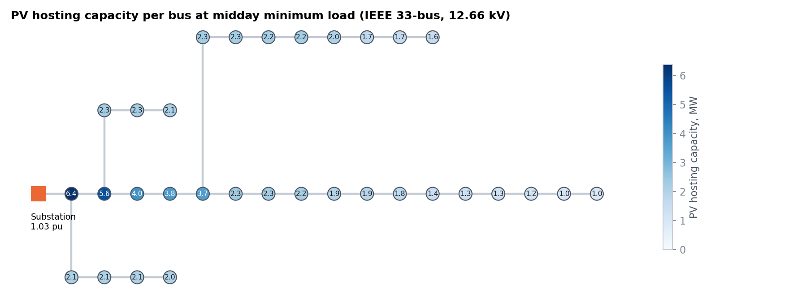
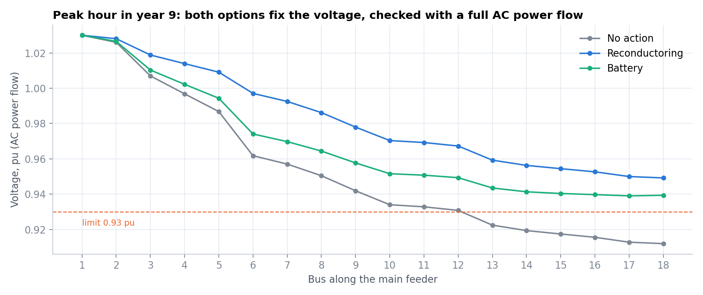
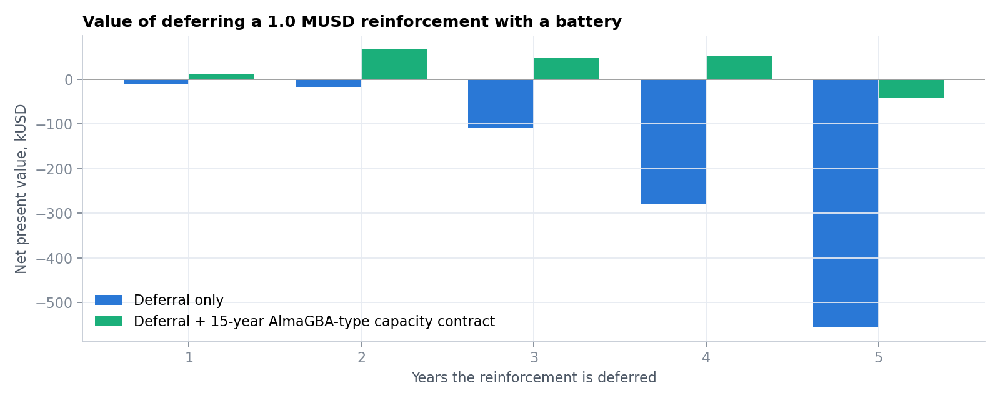
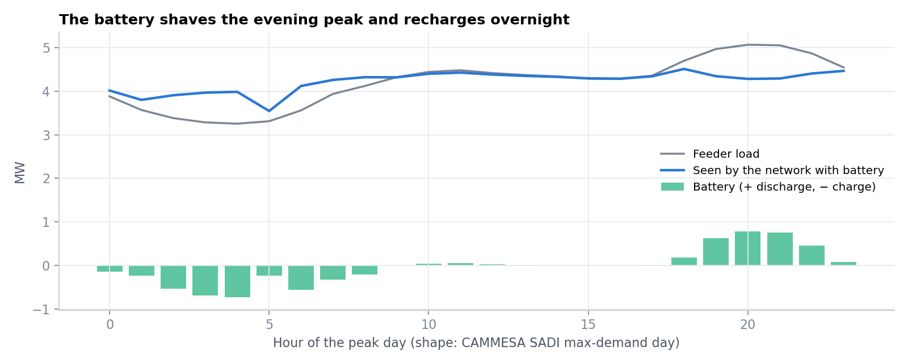

# Feeder hosting capacity and batteries as a non-wires alternative

A distribution planning study on the IEEE 33-bus feeder (12.66 kV) that answers three questions a distribuidora such as Edenor or Edesur faces:
1. How much distributed PV (Ley 27424) can each bus take?
2. When will load growth break the feeder?
3. Is a battery a cheaper way to defer reconductoring than doing it now?

It uses a linearised AC power flow (LinDistFlow) in Pyomo/HiGHS, with mixed-integer siting and reinforcement decisions. Every plan is checked with a full AC power flow.

> **ES:** Estudio de planificación de una red de media tensión (IEEE 33 barras): capacidad de alojamiento de generación distribuida por barra, año en que el crecimiento de demanda viola límites, y comparación entre recambio de conductores y baterías para diferir la inversión, incluyendo un contrato de potencia tipo AlmaGBA.



## Key results (all inputs editable)

| | |
|---|---|
| PV hosting capacity, midday at 30% load | **0.96 MW** at the feeder end (bus 18) to **6.4 MW** next to the substation |
| Binding limit | Thermal on 19 buses near the trunk, voltage (1.07 pu) on 13 buses at lateral ends |
| AC check at hosting capacity | max 1.068 pu, inside the 1.07 limit |
| Load the feeder can serve today | 1.16 × current peak, so the first violation comes in **year 5** at 3.5%/yr growth |
| Reinforcement sized for year 10 | **1.0 MUSD**, reconductoring 7.2 km of trunk (branches 2–6) |
| Battery to defer it 2 years | 0.13 MW / 0.35 MWh at bus 18 |
| Deferral value alone | negative for every deferral length |
| Deferral + 15-year AlmaGBA-type capacity contract | **+67 kUSD** NPV at 2 years of deferral |

**Reading.** On this feeder a battery does not pay its way through deferral alone. The constraint is at the far end, so a small battery placed there fixes the voltage, but the site cost and the 10% discount rate eat the saving. A battery pays once it also holds a capacity contract like the AlmaGBA agreements with Edenor and Edesur (683 MW of firm capacity in 11 plants). That is the case for distribution-sited storage in Argentina: network value stacked on a system contract.

## Checked against CAMMESA's AlmaGBA operating model

At the AlmaGBA operating workshop (CAMMESA and SACME, 8 October 2026), CAMMESA described how the Edenor/Edesur batteries are run:
- 683 MW of firm capacity in 11 plants (470 MW Edenor, 213 MW Edesur);
- dispatch planned weekly from the demand forecast and network state;
- a battery is called when **lines or transformers exceed 85% of capacity**;
- discharge at the winter night peak and the summer afternoon peak, charge in the early-morning valley;
- integration into CAMMESA's AGC.

Two checks against this model:
- **Dispatch shape.** The battery in this model only operates when a network constraint binds, discharging into the evening peak and recharging overnight (figure below). That is the same pattern CAMMESA uses.
- **The 85% trigger as a planning rule.** Applying the trigger to this feeder, branch loading first passes 85% at 1.03 × today's peak, so a battery would be called from **year 1**. Holding every branch at or below 85% through year 4, the last year before the feeder's limits bind, needs **0.6 MW / 2.3 MWh at bus 13**, a ~4-hour battery that matches the AlmaGBA specification.




## Method

- **Network** (`src/feeder/network.py`). The IEEE 33-bus test feeder (Baran & Wu, 1989). A backward-forward-sweep AC power flow reproduces the published base case (202.7 kW of losses, 0.9131 pu minimum voltage at bus 18).
- **LinDistFlow** (`src/feeder/model.py`). Squared-voltage variables with the linear drop v_j = v_i − 2(rP + xQ). Thermal limits use an octagon around the apparent-power circle. In planning runs a 0.005 pu margin covers the losses LinDistFlow ignores.
- **Hosting capacity.** One LP per bus maximises PV injection at midday minimum load. The binding constraint is identified by re-solving with thermal limits relaxed.
- **Planning MILP.** Per-branch binaries choose reconductoring (half the impedance, twice the rating, cost by length). The product of binary and flow is linearised exactly with big-M. Per-bus binaries site up to two batteries, with continuous MW/MWh and a daily state-of-charge cycle. The model minimises capex over the peak day, whose hourly shape is the maximum-demand day from CAMMESA SADI data.
- **Deferral economics.** Reinforcement now versus a battery that pushes it back n years. Reported with and without a capacity payment at the AlmaGBA award average (11,619 USD/MW-month over 15 years).



## Assumptions to challenge

- **Substation voltage and limits:** substation at 1.03 pu (OLTC) and a ±7% voltage band. Check the band against the ENRE quality rules for your concession.
- **Ratings:** branch ratings = max(1.2 × nominal peak flow, 2 MVA). IEEE 33 publishes impedances, not conductors.
- **Lengths:** derived from resistance at 0.30 Ω/km.
- **Costs:** reconductoring at 140 kUSD/km. A distribution-scale battery at 300 USD/kWh + 150 USD/kW + 80 kUSD per site.

## Run it

```bash
conda env create -f environment.yml && conda activate energy-portfolio
python data/fetch_data.py # CAMMESA SADI demand for the peak-day shape (not redistributed)
python run_feeder.py      # ~5 min; figures and CSVs -> results/
```

## Extending it

- Swap in a real feeder (pandapower or OpenDSS export) through `Feeder`.
- Add a time series of PV under Ley 27424 together with growth.
- Value the battery's spot arbitrage (see [argentina-bess-valuation](../argentina-bess-valuation)).

---
Pedro Schiaffi · [LinkedIn](https://www.linkedin.com/in/schiaffipedro) · MIT licence
